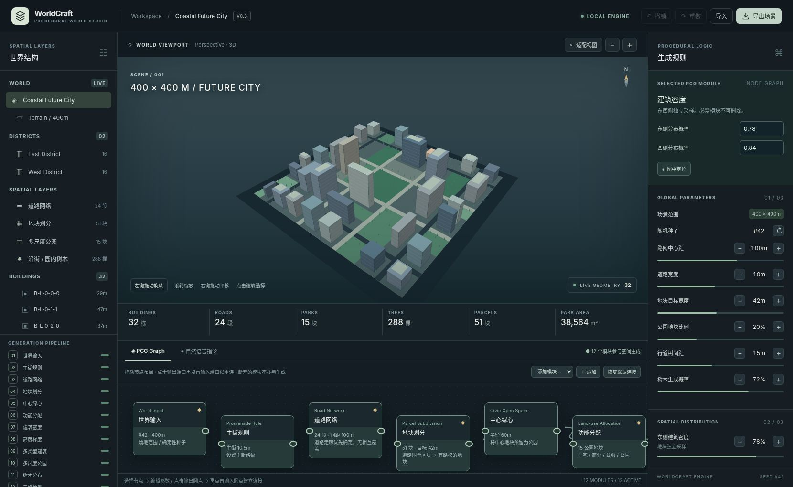
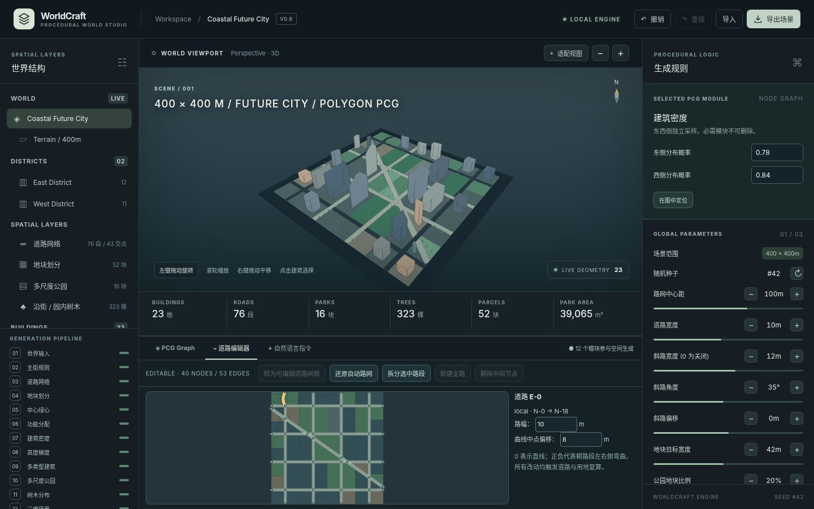

> **V0.6 新增**：可编辑道路中心线拓扑（稳定节点/路段 ID）、路口拖拽、有限支路、道路分段/合并、道路宽度编辑、多边形重算与约束校验回滚、局部地块 ID 保留，详见 [Road Topology V0.6](docs/ROAD_TOPOLOGY_V05.md)。
>
> **V0.4 新增**：斜向直线道路的角度/偏移/路幅控制，真实凸多边形道路裁切、非矩形地块、建筑多边形退界和树木几何避让。详见 [Road Geometry V0.4](docs/ROAD_GEOMETRY_V04.md)。

# WorldCraft V0.6 — Natural-Language Procedural World Studio

以**自然语言 + 可编辑 PCG Graph + 确定性的空间规则**构建可持续修改的三维城市。首版空间链路已从基础建筑体量，扩展为 **道路网络 → 地块划分 → 功能分配 → 多类型建筑 / 多尺度公园 → 道路与地块协调的树木**。



## V0.6 操作入口

在工作台底部打开「⌁ 道路编辑器」，先点击「转为可编辑道路网络」，再选择并拖拽道路节点、选路段调整路幅、拆分道路或添加支路。所有编辑在提交前经过场景几何校验，可能因产生无临路地块而被拒绝。

通过自然语言指令可以尝试「将路口 N-0 向东移动 5m」「路段 E-0 宽度设为 12m」。自然语言仍是离线可审核的指令语法，**不是自主推理的通用 AI Agent**。

## 立即运行

浏览器下载并打开 `worldcraft.html` 即可进入离线预览，无需 API Key、npm 安装或登录。建议使用 Chromium/Chrome 或 Edge；不支持 WebGL2 的浏览器将回退到 Canvas 软件 3D 预览。

开发模式（Node >= 18）：

```bash
npm run verify
npm run serve
# 浏览器访问 http://localhost:5190
```

`npm run build` 根据 `index.html`、`styles.css` 与 `src/` 构建最新单文件 `worldcraft.html`。

## V0.4 核心功能

- 旋转 / 缩放 / 平移 3D 场景，选择建筑查看功能、类型、位置、面积。
- 12 模块 PCG Graph：拖动节点、端口重连、插入/绕过可选规则，必需依赖不能越过。
- 结构化道路面、多块与道路相接的地块、住宅 / 商业 / 公服建筑、面积分级的小中大公园。
- 行道树沿**真实路侧地块边界**分布，公园内部以规则采样，并严格避让道路、建筑和其他树冠。
- 参数编辑、自然语言指令、Undo/Redo、场景 JSON 导入导出、方案指标比较，继承自 V0.2 的核心操作。
- 同一场地、随机种子和参数得到一致的全部生成结果；局部东西密度修改保留另一侧建筑实例。

### 可用的离线自然语言示例

```text
生成一座 400×400m 的未来城市
道路间距设为 80m
道路宽度设为 12m
地块目标设为 35m
公园比例设为 35%
行道树间距设为 12m
树木密度设为 50%
建筑退界设为 8m
将东侧建筑密度降低 30%，其他区域不变
禁用中心绿心
```

自然语言解析为**可审计的预制规则指令**，不是开放域大模型。复杂文本转通用 PCG DAG、自由绘制道路、生成复杂地形/河道不在这一版范围内。

## 重要代码

| 文件 | 职责 |
|---|---|
| `src/spatial.mjs` | 全阶段生成、阶段依赖元数据、空间几何冲突校验、未来 terrain/hydrology 扩展槽 |
| `src/pcg.mjs` | 世界参数 Schema、确定性随机数、离线命令解析、导入导出 |
| `src/graph.mjs` | 可视化单链路执行 Graph、必需依赖、连接、旧版节点迁移 |
| `src/renderer.js` | WebGL2 与 Canvas 的道路 / 地块 / 建筑 / 公园 / 树木三维预览 |
| `src/app.js` | UI 状态、节点参数面板、场景树、命令、比较、撤销重做 |
| `tests/*.test.mjs` | 计算、拓扑、参数、稳定性与布局冲突测试 |
| `tests/browser_spatial.py` | Chromium 中的节点编辑、参数更新、Undo/Redo、自然语言与 JSON 往返测试 |
| `docs/PCG_PIPELINE.md` | 阶段依赖、关键数据结构、参数表、算法边界与扩展方案 |

## 本版验收（seed #42，400×400m）

| 道路段 | 地块 | 建筑 | 公园（小/中/大） | 树木（街道/公园） | 平面冲突 |
|---:|---:|---:|---:|---:|---:|
| 24 | 51 | 32 | 15（3/8/4） | 288（234/54） | 0 |

- `npm test`：18/18 项测试通过，覆盖完整生成链及包含 100 组参数组合的布局冲突回归测试。
- 附加 100 组不同场地尺寸 / 路网间距 / 随机种子的冲突遍历：100/100 有效。
- `tests/browser_spatial.py`：Chromium 浏览器交互验收通过。

> **限制：** 当前生成道路是正交道路网；公园为矩形地块，树林采用二维树冠投影冲突校验。参数中的「公园地块比例」是采样概率，不等于最终面积占比；中心绿心会额外指定公园地块。水系与地形仅保留扩展合同，尚未实现。项目目前是程序化三维场景原型，不能替代工程规划审批或高精度交通/环境计算。

详细规则与验证协议请阅读 [PCG Pipeline 设计文档](docs/PCG_PIPELINE.md)。

## V0.4 斜路与多边形地块

- 默认场景启用 12m、35° 的斜向主路；可在右侧“道路网络”模块和全局参数中调整斜路宽度、角度与偏移。
- 自然语言支持：`斜路角度设为 50 度`、`斜路偏移设为 -20m`、`斜路宽度设为 16m`、`关闭斜路`、`添加斜路`。
- `diagonalWidth=0` 可以切回 V0.3 的直交路网；旧场景导入会自动选择此兼容模式。
- 道路、地块、公园与建筑的实际占地基于多边形，不是旋转的矩形贴图。
- **V0.4 的“拓扑编辑”是有限制的：编辑贯通道路的角度、宽度与位置，从而改变交点与街区；尚未提供鼠标自由拖拽道路顶点或任意复杂曲线网络。**

测试：`npm run verify`（含基础回归与新多边形测试）；浏览器手工验收建议使用 `npm run serve`。




## V0.6 · Compound Regions & Curved Roads

- 可编辑道路边新增 `bend`（-30m～30m）控制二次 Bézier 曲线实际中点偏移；单文件版道路编辑器可直接修改，并支持「路段 E-10 弯曲设为 8m」等离线自然语言指令。
- 曲线采样生成道路面，内部弯折处有联合连接面并保证道路占地面片无正面积重叠。
- `src/region.mjs` 将共边的凸分片合并为一个具有 `outer / holes / cells` 的复合地块，已支持凹多边形及带洞表示和真实洞边界避让。
- 建筑、公园与树木使用地块的实际复合几何进行验证，渲染继续通过 `cells` 防止孔洞被错误填满。
- JSON 兼容旧道路 V1 文件，读入时自动设 `bend:0` 并升级成 V2；当前世界 Schema 保持 V4。
- **边界**：曲线是二次 Bézier 分段近似，不代表道路工程几何；含洞逻辑已做合成验证，但默认场景不一定出现自然洞；曲线拆分暂时拒绝以保留几何正确性。

详见 [`docs/REGION_GEOMETRY_V06.md`](docs/REGION_GEOMETRY_V06.md)。
