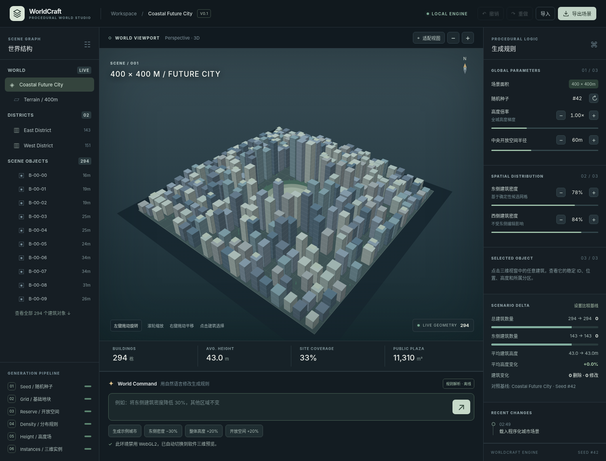

# WorldCraft V0.1 — Natural Language Procedural World Builder

一个真正可交互的、完全离线可用的程序化三维未来城市编辑器。生成内容是通过确定性 PCG 规则创建的 3D 几何，不是图片或视频。



## 立即体验（无需安装依赖）

**直接双击 `worldcraft.html` 即可用浏览器打开。** 建议 Chrome / Edge（支持 WebGL2）。无需服务器、API Key、npm install、登录或联网。

开发版：在项目目录运行 `python3 -m http.server 5190`，浏览器打开 `http://localhost:5190`。开发版使用 ES Modules，因此需要本地服务器，**不能**直接双击 `index.html`。

## 使用说明

- 左键拖动：旋转 3D 视角；滚轮：缩放；右键拖动：平移
- 单击建筑：查看稳定对象 ID、位置、高度、基底面积
- 左侧：浏览建筑层级，点击建筑定位
- 右侧：点击 ± 调整城市密度、中央开放空间半径、建筑高度倍率
- 底部：输入自然语言指令（回车执行，Shift+Enter 换行）
- 顶部：撤销 / 重做、JSON 场景导入与导出
- 比较面板：设置当前场景为新基线，跟踪增删建筑数量和几何指标变化

### 支持的自然语言示例

1. `生成一座 400×400m 的未来城市，中心高外围低，保留中央开放空间`
2. `将东侧建筑密度降低 30%，其他区域不变`
3. `提高西侧建筑密度 10%`
4. `整体建筑高度提高 20%`
5. `扩大中央开放空间 20%`
6. `广场半径设为 70m`
7. `随机种子设为 72`

**重要说明：** V0.1 使用可审计的、规则化的中文指令解析器，不是真正可理解任意自然语言的 LLM。没有连到 OpenAI 等云模型，也不声称具备通用世界生成能力。无法识别的命令会给出提示而不会暗中执行。

## 原理

Natural Language → Controlled Intent Parser → Validated World Schema → Deterministic PCG Engine → WebGL2 Instanced Mesh Viewer

- 世界使用局部米制坐标（无需地图数据）；场景为 400×400m（可以生成 200–800m、20m 步长的方形地块）。
- 20m 网格中的每个格子通过 `seed + row + col + random channel` 独立确定是否布置建筑、造型参数和高度；建筑 ID 是稳定的 `B-row-col`。
- 以中央开放空间禁建区、倾斜景观廊道、东/西密度阈值、高度距离衰减场共同控制生成结果。
- 只修改东侧密度时，不会重新抽取或移动西侧的建筑。可用测试验证。
- 修改完记录世界参数，持久化于 localStorage；导出 JSON 时保存结构化规则及 seed，而非单独的 Mesh。
- 交互渲染首选 WebGL2 自带 instanced draw call；当浏览器或远程沙盒禁用 WebGL2 时，自动切换到 CPU Canvas 透视三维投影。两者均支持轨道摄像机与建筑拾取，无第三方运行时依赖。

## 技术决策

最初建议采用 React + Three.js，但此交付环境无法联网安装依赖。为保证**当前交付是真实可运行的产品，而非不能启动的项目骨架**，首版使用原生 JavaScript + WebGL2；PCG、渲染、应用交互模块已解耦，便于未来更换为 React / React Three Fiber。未来可接入 Function Calling，把语言解析从模板词法提升为严格结构化的模型输出。

## 代码结构

```
index.html            源 HTML
styles.css            工作台样式
src/pcg.mjs           世界 Schema、PCG、命令解析与验证
src/renderer.js       WebGL2 三维实例渲染 + Canvas 3D 后备方案、摄像机和拾取
src/app.js            交互、状态、撤销重做、比较与导入导出
build.mjs             零依赖打包，生成单文件 worldcraft.html
worldcraft.html       可直接双击打开的独立 HTML 应用
tests/pcg.test.mjs    PCG 与核心指令测试
.github/workflows/ci.yml  GitHub Actions 持续集成
```

## 运行测试与打包

```bash
node --test tests/pcg.test.mjs
node build.mjs
```

## V0.1 的产品边界

- 自然语言解析仅支持受控的几种指令，并非任意需求的语义理解。
- 只支持一种未来城市建筑风格和预设 PCG 节点序列。不能编辑自由 PCG 节点图。
- 不包含用户上传建筑资产、复杂地形、地理坐标系统、道路网络仿真、Blender 导出或 GLB 导出。
- 基本建筑形态、屋顶及植被是程序化几何代理，非游戏生产级资产。
- 当前东侧/西侧按照世界 X 坐标分割；不随摄像机旋转而变化。
- 编辑密度可能移除建筑而非连续缩小全部建筑；所谓“密度下降 30%”指生成**概率参数**乘以 0.7，因此实际建筑数会在随机采样下接近、但不保证精确下降 30%。
- Undo/Redo 仅在当前会话可用；浏览器刷新后保留最近场景参数及比较基线，但不恢复撤销历史。

## 下阶段建议

1. 将结构化空间规则抽象为正式的节点 / 有向图，可调节依赖并局部重新计算。
2. LLM 通过 JSON Schema + 函数调用输出安全、可验证的编辑命令。
3. 引入建筑资产库、GLB/Blender 导出与美术深化。
4. 支持鼠标范围选择及针对任意选区的局部编辑，而不只是东/西两区。