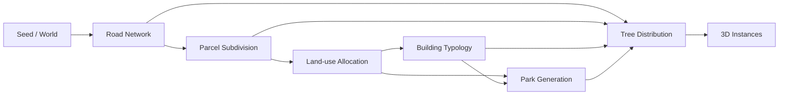

# WorldCraft V0.3 · 空间 PCG 设计与阶段依赖

## 目标与边界

采用局部平面米制坐标 (x,z)，以**同一组空间事实数据**驱动可配置节点图、道路与地块几何、建筑、公园、树木与 WebGL/Canvas 视窗。所有物体的稳定 ID、位置和尺度均由输入参数、场地和随机种子决定。V0.3 提供**正交道路网络**和**矩形地块**，不表示实际规划审批、道路交叉口标准、真实交通模拟或高差道路。

## 1. 严格依赖定义

运行态的阶段声明在 `src/spatial.mjs → STAGE_DEPENDENCIES`，界面执行依赖在 `src/graph.mjs → ORDER`。其中 `plaza` 和 `promenade` 为可选规则（前者作用于功能分配，后者作用于主街路幅）；`height` 为可选高度倍率。**必需阶段**不可从有效图链路中绕过。

| 阶段 | 上游依赖 | 产物 | 责任与不变量 |
|---|---|---|---|
| seed | 无 | world, seed | 单位、配置验证与种子 |
| roads | seed；可选 promenade | `roads[]`, `roadLines[]` | 先形成全域路廊；纵向走廊覆盖交叉口、横向路面在交叉口外裁切，无道路面相互覆盖 |
| parcels | roads | `blocks[]`, `parcels[]` | 道路外矩形分区与条形地块；地块不压入道路，每块至少有一处道路邻接 |
| landuse | parcels；可选 plaza | `parcels[].use` | 用 `parkShare` 与中心绿心规则确定 `residential/commercial/civic/park`，保证 park lot 无建筑 |
| buildings | landuse；density, height | `buildings[]` | 按用地功能与东西密度采样，包含退界和独立高度场；住宅有 slab / terraced / tower，另有 commercial / civic |
| parks | landuse, buildings | `parks[]` | 公园是**功能为 park 的完整地块**，依面积归类 small / medium / large |
| trees | roads, parcels, buildings, parks | `trees[]` | 行道树只沿真实路侧地块边缘，园内树以规则网格采样，树冠避让路面和建筑及其他树冠 |
| instances | 全部 | `scene` | 各类生成结果统一供视窗、指标、导出与测试读取 |



### 单流节点图边界

V0.3 的**UI 节点图仍是依赖顺序约束下的单数据流链路**，并非 Houdini 式任意多端口 DAG。领域级空间阶段声明支持多个上游依赖，执行器按固定顺序依次消费已生成的产物；未来支持多端口时可以直接利用 `STAGE_DEPENDENCIES` 绑定 typed inputs。拖动节点改变版面，合法连接改变可选模块参与状态；绕过必需模块会使图失效，此时保留上一次有效场景而不是生成不完整数据。

## 2. 关键结构

### 道路片段 `Road`

```js
{ id:'R-V-1', orientation:'NS', kind:'promenade',
  bounds:{x0:-55.25,z0:-200,x1:-44.75,z1:200},
  x:-50,z:0,width:10.5,depth:400,area:4200 }
```

片段为**不相互重叠**的 axis-aligned road footprints。`roadLines[]` 另外保留中心轴线供后续路口、交通网络和水系穿越逻辑使用。横向道路在竖向路廊处截断道路面，但其中心线保持贯通。

### 地块 `Parcel`

```js
{ id:'L-2-3-1', blockId:'BL-2-3',
  bounds:{x0:55.25,z0:55.25,x1:100.125,z1:145},
  x:77.6875,z:100.125,width:44.875,depth:89.75,
  area:4027.53,frontageIds:['R-V-2'],use:'commercial',parkClass:null }
```

四种用途：`residential`、`commercial`、`civic`、`park`。公园分类通过 **面积阈值** 确定，属于该地块的 `use`，不是覆盖在建筑上的装饰贴片。

### 建筑、绿地和树木

```js
building = {id:'B-L-2-3-1',parcelId:'L-2-3-1',use:'commercial',
  type:'commercial',x:78,z:100,width:30,depth:25,height:45,
  bounds:{x0:63,z0:87.5,x1:93,z1:112.5},footprint:750};
park = {id:'P-L-2-2-0',parcelId:'L-2-2-0',kind:'large',
  bounds:{x0:-44.75,z0:-44.75,x1:44.75,z1:44.75},area:8010.25};
tree = {id:'TS-L-2-3-1-0-0',parcelId:'L-2-3-1',kind:'street',
  x:60,z:79,height:5.2,crownRadius:1.5};
```

以上为 **结构示意值**，并非 seed #42 的精确实体取值。使用 `npm run inspect` 查看真实 seed #42 的当前指标。

## 3. 可配置参数（`src/pcg.mjs → DEFAULT_WORLD`）

| 参数 | 默认 | 单位 / 范围 | 效果 |
|---|---:|---|---|
| `size` | 400 | m，200–800、20 的倍数 | 正方形场地尺寸 |
| `seed` | 42 | int，0–1e9 | 稳定分布 |
| `roadSpacing` | 100 | m，60–160、20 的倍数 | 路网中心线间距 |
| `roadWidth` | 10 | m，6–22 | 基础道路宽度 |
| `promenadeWidth` | 10.5 | m，4–28 | 开启主街节点时与基础路幅取较大值 |
| `parcelTargetWidth` | 42 | m，25–90 | 每区块划分的目标尺度；实际尺寸受道路与区块制约 |
| `parkShare` | 0.20 | 比例，0–0.65 | 除中心绿心之外的公园地块基础概率，必要时补足面积类型 |
| `parkSmallMaxArea` | 1500 | ㎡，200–3000（UI） | 小公园面积上限（不含端值） |
| `parkLargeMinArea` | 3400 | ㎡，3000–12000（UI） | 大公园面积下限（含端值） |
| `plazaRadius` | 60 | m，20–160 并受场地限制 | 中心绿心影响范围，作用于地块用地分配 |
| `eastDensity`, `westDensity` | .78 / .84 | 0–1 | 东西侧建筑生成概率，局部编辑不影响另一侧 |
| `heightScale` | 1 | 倍率 0.2–3 | 建筑类型和中心高度场倍率 |
| `buildingSetback` | 7 | m，3–10 | 建筑足迹相对地块边缘的最小退让 |
| `treeSpacing` | 15 | m，8–35 | 行道树沿临路边界的采样间距 |
| `treeRoadSetback` | 4 | m，2.5–8 | 行道树树干相对道路面边界的内缩距离 |
| `treeDensity` | .72 | 0–1 | 树木采样概率 |
| `parkTreeSpacing` | 15 | m，8–35 | 公园内部采样网格 |
| `treeCrownRadius` | 1.5 | m，0.8–2.5 | 树冠二维避让半径 |
| `treeBuildingClearance` | 1.3 | m，0–5 | 树冠与建筑基底附加净距 |

**补充**：`parkShare` 是概率，不是承诺最后公园面积恰为 20%。为了让各尺寸公园可展示，生成器可在该概率之上补足可用面积类型；启用 `plaza` 时，中心绿心范围内地块也将被定为公园。地块分割由区块宽高、目标宽度和种子共同控制。对于固定场地和参数，生成结果完全确定。

## 4. 几何校验契约

校验函数：`validateSpatialInvariants(scene)`。

- 道路、地块、建筑、公园均不能越界。
- 同类道路、地块、建筑、公园内部均不得在**正面积**上重叠（共享边界允许）。
- 道路与地块、建筑、公园不交叠；建筑与公园互斥。
- 建筑与其所属地块绑定，建筑足迹完全在地块内部。
- 每个地块有真实道路临接（`frontageIds`）。
- 树木在所属地块内；以 `treeCrownRadius` 为圆盘对道路、建筑及树冠两两进行避免碰撞校验；建筑额外净距 `treeBuildingClearance`。
- 道路片段面积 + 地块面积应覆盖全部场地（按数值精度容许极小误差），不应存在未分类的平面裂缝。

## 5. 保存与旧版迁移

世界对象使用 `schemaVersion:2`，Graph 使用 `version:2`。JSON 导出的是**参数与节点拓扑**，不保存巨大派生网格；重新打开用同一输入复算，因而结果稳定。旧 `schemaVersion:1` 和 `Graph version:1` 文件可读入并迁移到新的完整空间阶段链，尽量保留旧的三个可选节点开关。

## 6. 水系与地形扩展点（当前不生成）

`EXTENSION_SLOTS` 声明了 `terrain` 与 `hydrology` 两个扩展槽，其入口位于**道路网络之前**：

1. `terrain.heightField(x,z) → meters` 可提供道路与地块高程、坡度、标高限制。
2. `hydrology.protectedPolygons[]` 可提供不可占用水域、河岸控制带和桥梁跨越约束。
3. 扩展数据到来后应先经空间约束层生成 `buildableMask` / `roadNetworkConstraints`，**由道路阶段消费**，而不是等建筑、树木生成后再切几何。
4. 本版 `world.extensions` 显式保留 `{terrain:null,hydrology:null}`；传入非空扩展将被拒绝，避免悄悄忽略用户数据产生错误场景。

水系、真实地形高差、弯曲道路、非矩形地块、建筑消防/日照规范，以及道路真实拓扑连通性评估均不在 V0.3 的验证范围。

## 7. 本地验证方法

```bash
npm run verify                 # 单元测试 + 独立 HTML 构建 + 一致性报告
python3 tests/browser_spatial.py # 可选：需要 Python Playwright 与 Chromium
```

固定种子 42，400m×400m，生成 24 段道路面、51 个地块、32 栋建筑、15 块公园（小 3 / 中 8 / 大 4）、288 棵树（行道 234 / 园内 54）。还对 100 组场地尺寸、路网间距与种子参数组合进行了批量碰撞校验，全部通过。数值属于当前算法回归基准，不是物理世界真实数据。
