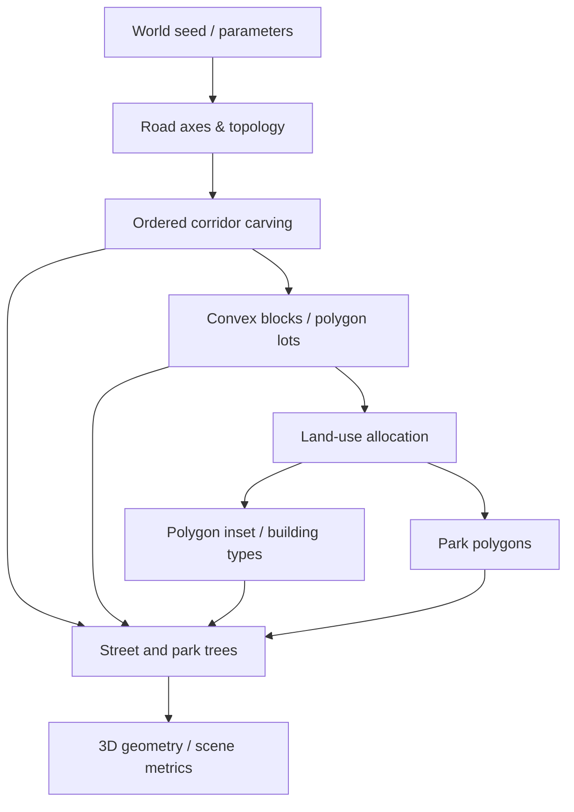

# WorldCraft V0.4 · 可配置斜向路网与凸多边形地块

## 方案决策（对 V0.3 的批判性重构）

V0.3 依赖 AABB（axis-aligned bounding boxes）同时担当视觉形态和实际几何判断。只对长方形成立。**V0.4 采用真实的凸多边形顶点作为空间事实数据**，所有道路占地、建筑退界、树冠净距和面积碰撞校验使用 `vertices`；`bounds` 只用于快速定位或相机拾取。原版直交路网仍通过 `diagonalWidth=0` 向后兼容。

### V0.4 限定能力

- 道路中心线：先生成完整贯通场地的正交道路轴线，再增加一条可编辑角度 15°–75°、宽度 6–22m、中心偏移的斜向穿越道路。斜路宽度为 0 表示禁用。
- 根据道路中心线求交产生 `roadGraph.nodes[]` 和 `roadGraph.edges[]`；交点真实位于城市范围内，拓扑需连通。
- 每条道路按法向双向扩展形成走廊，并从剩余用地中**顺序裁切**。已被先行道路占用的面积不再重复分配，地块残余成为凸多边形。
- 地块沿 x 或 z 方向试探分割，只有所有子地块均有可计算道路临接时才保留分割结果，否则保留大区块；不制造无路权地块。
- 建筑在完整凸多边形内执行 inward offset（按边做半平面内缩）；使用再缩放的凸多边形建筑基底，保证退界。公园保留对应地块全部多边形边界。
- 树木按真实沿街共边及公园网格采样，使用凸多边形包含、圆-多边形距离和圆-圆最小距离进行避让。
- 场地地形、水系仍然只保留前置约束接口。不能把插入河道、多高程道路、任意曲线和街区自动寻路称为已实现。

## 生成管线与依赖



| Stage | Inputs | Output | Critical invariant |
|---|---|---|---|
| Road axes | site size / spacing / angle / width / offset | `roadGraph`, `roadLines[]` | 连通性；中心线交点记录 |
| Road corridor carving | road axes / prior occupied corridors | `roads[].vertices` | 道路面片正面积不重叠 |
| Block and parcel carving | remaining site polygons / targetWidth | `blocks[]`, `parcels[]` | 道路与地块无重叠，地块有临路边 |
| Land-use | parcels / parkShare / plazaRadius | `parcels[].use` | 功能互斥 |
| Building typology | assigned parcels / setback / density / height | `buildings[].vertices` | 对地块所有边满足退界 |
| Park allocation | park parcels | `parks[].vertices` | 公园与建筑不交叠 |
| Tree placement | frontage segments / setbacks / geometry | `trees[]` | 树冠不越界、不碰撞道路/建筑/树冠 |

## 数据结构与参数

```js
roadAxis = {id:'axis-oblique',from:[x,z],to:[x,z],width:12,kind:'arterial'};
roadGraph = {nodes:[{id:'J-...',x,z}],edges:[{id,from,to,axisId,width}]};
polygon = {id,vertices:[[x,z],...],bounds:{x0,z0,x1,z1},area,x,z,width,depth};
parcel = {...polygon,frontageIds:['axis-oblique'],frontageEdges:[{from:[x,z],to:[x,z],roadId}],use:'park'};
building = {...polygon,parcelId,type,height,footprint,region};
```

| Parameter | Initial | Validation |
|---|---:|---|
| `diagonalWidth` | 12m | 0=off; else 6–22m |
| `diagonalAngle` | 35° | 15°–75° |
| `diagonalOffset` | 0m | ±siteSize/3 |
| `roadSpacing` | 100m | 60–160m, multiple of 20 |
| `roadWidth` | 10m | 6–22m, less than spacing/3 |
| `parcelTargetWidth` | 42m | 25–90m |
| `buildingSetback` | 7m | 3–10m |
| `treeRoadSetback` | 4m | 2.5–8m |
| `treeCrownRadius` | 1.5m | 0.8–2.5m |

## 数学与误差契约

- 剪裁对象为**凸多边形**，采用直线半平面 Sutherland–Hodgman 裁切；不支持凹多边形、holes 或复杂道路端头。
- `area(roads) + area(parcels) ≈ area(site)`，固定 0.25㎡ 浮点累积容差。
- 正面积重叠阈值 `1e-4㎡`；共边或点接触不算面积冲突。树木圆盘还需检查点到边的最短距离。
- 使用场地局部米制坐标，不进行大地坐标、真实交通容量或法定退界合规认证。
- 随机数来自位置、参数及 `seed` 的确定性整数哈希。相同输入 JSON 导出后重算结果应完全一致。

## 从旧版迁移

`schemaVersion=3`，旧 V0.1 / V0.2 / V0.3 文件 (`schemaVersion=1/2`) 迁移时默认 `diagonalWidth=0`，保留旧正交布局。新建 V0.4 世界默认开启一条斜向主路。PCG Graph 保持 v2、执行阶段顺序不变，`roads` 节点增加新的路网参数。

## V0.5 前的核心缺口

1. 真正可逐段拖动、增删顶点的道路拓扑编辑，不局限一条贯通的斜路。
2. 凹多边形、混合曲线与路口边界计算需要专业 polygon boolean / offset 几何库及数值稳健性测试。
3. 道路人车通达性、河流穿越和真实高差约束尚未集成。
4. 当前城市生成对路网改动会重建完整地块拓扑；改变路形后保持**未受影响地块的稳定 ID** 仍需额外增量映射策略。
