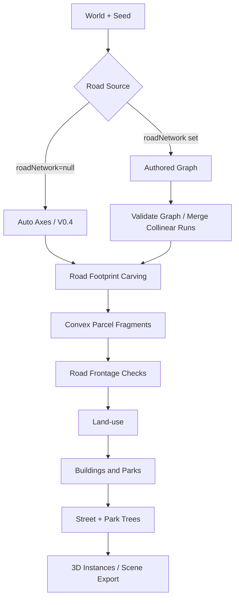

# WorldCraft V0.5 · 可编辑道路拓扑与空间增量稳定性

## 定位

V0.5 在 V0.4 的确定性道路→地块→用地→建筑/公园→树木流程上引入**真实有限长、可编辑的道路节点/路段网络**。本轮不引入外部依赖；使用本地平面米制 X/Z 坐标、凸多边形布尔裁切和可审核的几何校验来控制编辑风险。

## 编辑操作与界面

- 打开底部 **⌁ 道路编辑器**，点击“转为可编辑道路网络”。生成的原有路网拓扑会转换成独立的、可持久化的节点与路段数据。
- **拖动路口圆点**：调整道路端点和关联路线，提交后重算道路、地块、功能、建筑、公园、树木。
- **选路段**：右侧栏可修改道路宽度（6–22m），并可“拆分选中路段”。
- **选路口**：点击“新建支路”，再点击平面中的新终点，创建一条有源节点的有限长度支路；可删除度数 1 或 2 的道路节点。
- **还原自动路网**：将 `roadNetwork` 重设为 `null`，恢复由 `roadSpacing`、`diagonalAngle` 等生成的道路规则。
- 自然语言支持明确的受控操作，如 `将路口 N-0 向东移动 5m`、`路段 E-0 宽度设为 12m`，不是自由语义理解。
- 撤销、重做、版本比较、场景 JSON 导入/导出与原有 PCG Graph 保持相同的项目状态。

## 核心数据结构

```ts
interface EditableRoadNetwork {
  version: 1;
  nodes: { id: string; x: number; z: number }[];
  edges: { id: string; from: string; to: string;
           width: number; kind: 'local' | 'arterial' | 'promenade' }[];
}

interface WorldV4 {
  schemaVersion: 4;
  // 原有 World 参数省略
  roadNetwork: EditableRoadNetwork | null;
}
```

- `roadNetwork: null` = V0.4 自动路网；非空 = 作者编辑的道路网络优先于自动斜路参数。
- **道路节点、路段自身的 ID 在坐标改变后不变化**；自动计算出来的交叉点属于派生拓扑，不属于作者节点。
- 道路占地与地块用 `vertices: [x,z][]` 作为几何权威；`bounds` 只用来做包围盒加速。
- 不保存派生三维 Mesh；每次打开根据规则和种子重新计算。

## 生成阶段与依赖



1. **拓扑校验**：最多 180 节点、240 条道路；禁止节点重复、重合和路段自环；禁止共线正长度重叠；禁止断开的作者网络。交叉线段在派生道路拓扑中自动识别相交点。
2. **有限道路占地**：合并几何上连续且宽度、类型相同的共线路段，以消除不必要的分割。将各条有限宽度走廊与地块用凸多边形差集算法进行交叠扣除，路面非重复覆盖。
3. **地块及临路**：由道路扣除后剩余的凸多边形片生成地块，优先按可临路方向拆分；不允许产生无道路邻接的独立地块。
4. **下游重算**：继续用已有建筑退界、树冠避让、功能分配、地块面积核算执行；公园与建筑功能互斥。
5. **变更事务**：编辑操作先验证新规则，计算候选场景并调用 `validateSpatialInvariants`；有空间冲突或无临路地块时**拒绝提交**，保留旧场景和撤销历史。

## ID 稳定性与重新生成

- 道路控制节点 ID 例如 `N-23`，路段 ID 例如 `E-27`：与空间坐标分离，拖动不会更名。
- 由道路面裁切而来的地块块 ID，来自多边形顶点的规范化序列与哈希，而不是依赖运行顺序的数组下标；**完全不变的多边形**在重新计算后保留相同 ID。
- 同一输入对象与同一种子产生逐对象一致的输出。移动一个路口不会保证全部下游对象 ID 都不变化：几何形状发生改变的地块需要新的 ID；基于相邻关系的树木/功能也可能跟随变化。
- 采用 32 位几何指纹（量化到 1mm）；虽然适用于演示，**不能当作生产级无碰撞主键**，正式产品需加入稳定 UUID 与几何版本对应表。

## 几何边界

当前使用由凸多边形片构成的空间分区，并非通用的 GIS Polygon/MultiPolygon 内核。路网可以由多个**有限直线段**构成折线、交叉与短支路，交叉处由道路面并集组成，但尚不支持真正的 Bézier 曲线、半径连续路缘、道路高差/立交，以及复杂凹多边形作为**单一可编辑地块对象**。

对一些强制移动/急锐折路，可能生成过窄或无临路关系的残余地块；系统会阻止提交，而不是虚报“已自动修复”。这是 V0.5 的合理性保护，也是 V0.6 需要用通用多边形布尔内核与残余地块合并进一步完善的问题。

## 验证与范围

- `npm test`：包含基础 PCG、Graph/空间完整性、道路拓扑转换、节点移动、分段/合并、添加支路、编辑路幅、场景 JSON 迁移、确定性、稳定 ID、参数组合和错误拒绝测试。
- `npm run verify`：运行单元测试、构建完全离线的 `worldcraft.html`，并输出场景数值指标。
- `npm run serve`：启动开发版（依赖浏览器能访问本机 HTTP）。也可直接打开离线 `worldcraft.html`。
- 浏览器自动化因测试环境的 `ERR_BLOCKED_BY_ADMINISTRATOR` 限制无法完成；**静态代码与单元测试通过不代表浏览器拖拽交互已验收**。

## 下一步建议

引入成熟的 Polygon/MultiPolygon Boolean Geometry 引擎，以非凸地块和含洞地块为一等数据类型，进行零碎地块合并，并改进道路弧线及平面路口。随后再实现可控的道路等级/出入口语义、地块分割约束和自然语言更复杂的空间规划操作。
